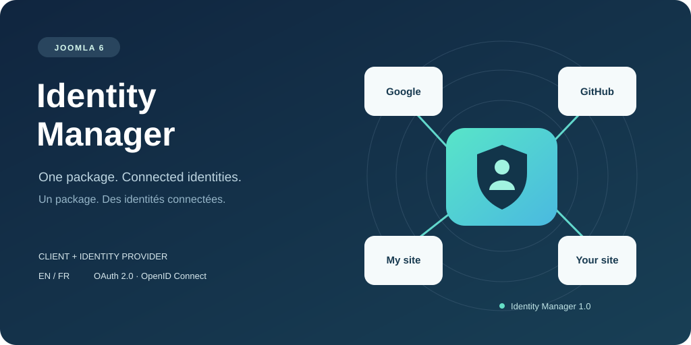

# Identity Manager for Joomla

[Français](README.fr.md) · [Download](https://github.com/YGomiero/identitymanager-joomla/releases/latest) · [Installation](docs/installation.en.md) · [Security](SECURITY.md)

Sign in to Joomla with an external identity, link an existing account, or create an account when the site's registration settings allow it. The **same package** can act as a client, a Joomla identity provider (master), or both.

- Joomla 6, PHP 8.3+, MySQL/MariaDB, HTTPS, PHP cURL and OpenSSL.
- French and British English interfaces and documentation.
- GitHub and Google through Hybridauth; configurable OAuth 2.0 / OpenID Connect providers.
- Joomla-to-Joomla authorization code flow with PKCE and optional consent.
- Site favicons, bundled Google/GitHub logos, accessible login buttons.
- Account linking/revocation, administrator logs, CSV archive, purge and retention settings.
- Joomla update server with SHA-256, SHA-384 and SHA-512 checksums.

Install **`pkg_identitymanager-1.0.1.zip`**, not GitHub's source-code archive. It contains the component, four plugins, translations and runtime dependencies. Composer is unnecessary on the destination site.

## Registration follows Joomla

New accounts require **both** Joomla Users → Options → Allow User Registration and Identity Manager → Automatic account creation. Closing either switch prevents external account creation, including when a login started before the change. Existing linked accounts still sign in. Administrator activation requires prior registration through Joomla; email self-activation requires a verified external email.

## Tested scope

The initial release was exercised on Joomla 6.2.0 / PHP 8.3.30 with real GitHub and Joomla-to-Joomla flows. Google is implemented but has not been verified with a live Google OAuth application. A local `.test` hostname is unsuitable for a Google web-client redirect. WordPress.com appears in the Hybridauth catalog; a self-hosted WordPress site needs its own OAuth/OIDC server extension and has not been tested.

The adapter catalog is not a certification of every provider. See [validation report](docs/validation.en.md), [configuration](docs/installation.en.md) and [third-party notices](THIRD_PARTY_NOTICES.md).

GPL-2.0-or-later for extension code. Dependency licenses and provider trademarks retain their own terms. No affiliation with Joomla, Google or GitHub is implied.
